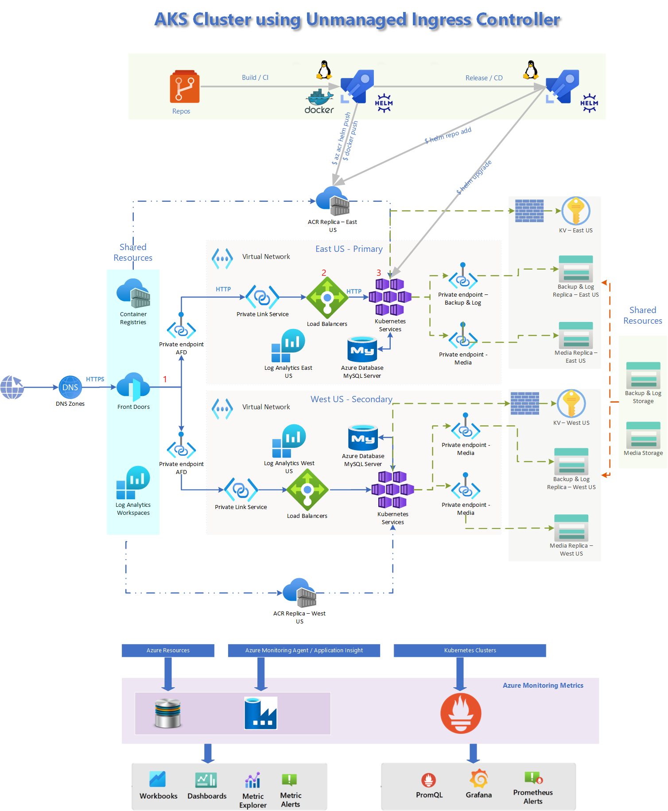
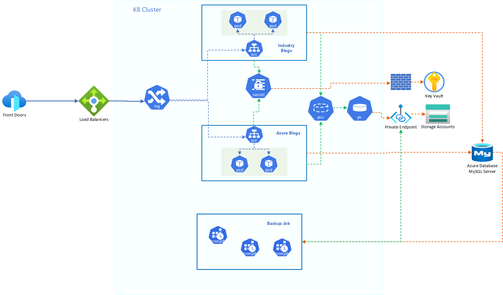

# Cloud Blogs System Re-architecting 

## Overview

This initiative revolves around the establishment of an Azure Kubernetes Service (AKS) cluster tailored for hosting cloud-based blog websites. The primary goal entails seamlessly transitioning the present websites from their current framework on Azure App Services to the AKS environment. The overarching purpose here is to curtail the expenditure on infrastructure by harnessing the potential of shared cluster resources to power these websites. Simultaneously, the project encompasses the creation of a robust disaster recovery (DR) setup to ensure operational continuity even in adverse scenarios. Looking ahead, this endeavor promises enduring advantages through the strategic integration of blog sites onto this advanced platform.

## Problem Statement and Goal

The existing architectural framework based on "Azure App Service" was initially designed to accommodate a limited number of hosted sites. However, with the steady increase in the number of sites, there has been a persistent upsurge in infrastructure expenses. As of 8/9/2023, the annual infrastructure outlay stands at $318K, equivalent to 12 monthly installments of $26.5K each. This cost encompasses the amalgamated expenditure for maintaining 8 distinct sites, namely Riskiq, Security Insider, Translator, M365, Industry, Azure Blog, Cloud Blogs, and Security Blog. The cost burden per site approximates $40K on an annual basis.

Anticipating the integration of new product-specific blogging sites, Microsoft's projections indicate the potential addition of 7 more sites. If we persist with the present architectural paradigm, the projected expenditure is set to escalate twofold to $636K.

Our core objective in transitioning to an AKS architecture centers around the strategic goal of reducing infrastructure expenditure by a range of 30% to 40%. The other benefits that an AKS Cluster brings in are:
- Faster provisioning of infrastructure for future websites.
- Better troubleshooting of the container.
- Auto-healing of the container in the event of unexpected crash.
- Faster scaling-out and scaling-in that helps in handling load spikes. 
- Quicker Disaster Recovery (DR) since all containers are in one place. 

## Architecture Diagram

The architecture diagram provides a visual representation of the key components within the cluster setup. It's designed with redundancy in mind, featuring both primary and secondary nodes that ensure smooth operations even during regional outages.

At the core of this architecture lies the AKS Kubernetes Service, which acts as the central hub for hosting application containers. The AKS cluster is configured as a public cluster, enabling Azure DevOps CI/CD pipelines to seamlessly interact with it.

- AKS Cluster Configurations: 
  - AKS Cluster is AAD enabled to authenticate using AAD.
  - Access control is configured using "Azure RBAC".
  - Uses "Azure CNI" plugin which means PODs are assigned IP from the "AKS vNet-Subnet." 
  - Ingress Controller: AKS cluster is configured with "Unmanaged Ingress Controller" in conjunction with an Internal Load Balancer. The ingress controller is responsible to route the traffic based on the domain name. 

- Load Balancer: Load Balancer front-end-Ip is a private IP. The ingress-controller service is of "Load Balancer" type, and it uses the private IP to expose the services.

- Private Link Service: Private Link Service is defined to ensure the communication between the Load Balancer and the Front Door takes place on the Azure Backbone network. No traffic navigates on the public network. It also ensures that no other service intercepts the communication and secures it.

- Front Door: Front Door is needed to expose one endpoint for both the clusters (primary and secondary). It is also responsible for load balancing, SSL offloading, protecting the service using WAF and DDoS protection.

The application manages four types of data:

- Site Contents: These are stored in a MySQL database, configured as External Services for the PODs to access.

- Site Media Files: Azure File Share is used to store media files, which are mounted to PODs using Persistent Volumes.

- Site Database Backups and Logs: Azure File Share is also employed to store database backups and logs, accessible by PODs through Persistent Volumes.

- Site Secrets and Configurations: Secrets and configurations are securely stored in Azure Key Vault.

All data repositories are isolated within the cluster's private network, ensuring privacy and security.

## Infrastructure Security

- The architecture is built upon the Azure Cloud platform, where the entire infrastructure takes residence. Access to this infrastructure is meticulously managed through PMI (Privileged Identity Management) access control, ensuring a secure and regulated entry point.

- A stringent security posture is maintained by encrypting both the AKS cluster API and AFD endpoints through SSL. This cryptographic layer safeguards data in transit, fostering an environment of trust and confidentiality.

- To maintain the sanctity of data, all data repositories are cordoned off within the vNet using either private endpoints or firewalls. This deliberate isolation ensures that data is encapsulated within a controlled environment.

- The lines of communication between AFD and the Load Balancer is on the Azure Backbone using Private Link Service (PLS). Though the communication between the entity is over unencrypted HTTP channel, the PLS ensure no interception in the channel. 

## Access Control

The AKS cluster is intricately set up with "Azure AD authentication coupled with Azure RBAC." In essence, this configuration signifies a dual-layered security approach. User access is meticulously verified against Azure AD, serving as the gatekeeper of authenticity. Subsequently, the granularity of privileges within the cluster is masterfully orchestrated through the orchestration of Azure AD in tandem with specialized Roles, forming a harmonious symphony of authorization and access control.

| AAD Group | Assigned Role | Privileges |
|-|-|-|
|cloudblogs-aks-cluster-admin|Azure Kubernetes Service RBAC Cluster Admin|Allows super-user access to perform any action on any resource. It gives full control over every resource in the cluster and in all names|
|cloudblogs-aks-dev-user|Azure Kubernetes Service RBAC Reader|Read-only access to see most of the objects in a namespace. It does not allow to view roles, role bindings, and secrets.|
|cloudblogs-aks-sre-user|Azure Kubernetes Service RBAC Writer|Allows read/write access to most objects in a namespace. It does not allow viewing/modifying roles or role bindings. However, has access to view secrets, run pods as any service account in a namespace.|

## Anatomy of K8 Cluster

        
**_1. Containerized Blogging Sites:_** The blogging websites are isolated and packaged within Docker containers, making them portable and consistent across different environments.

**_2. Deployment with Replica Set and POD:_** The website solution is managed through a Deployment, which ensures a specified number of identical instances (Replica Set) of the website are running as individual Pods. This provides reliability and scalability.

**_3. Cluster IP Exposures:_** Each website's Pod is assigned a unique Cluster IP, which is an internal IP address used for communication within the cluster.

**_4. Ingress for Domain-Based Routing:_** An Ingress resource directs incoming traffic from the internet to the right website Pod within the cluster. This routing is based on domain names, like a map guiding visitors to their chosen destination.

**_5. Storage and Logging:_** Each Pod has access to media and log storage resources through Persistent Volumes (PV) and Persistent Volume Claims (PVC). This ensures data and logs are stored reliably and separately from the Pod itself.

**_6. Key Vault Integration:_** The websites securely fetch secrets from a Key Vault using a StorageProviderClass, allowing them to access sensitive information without exposing it in their code.

**_7. MySQL Server Accessibility:_** The MySQL server is reachable within the cluster, but its interaction is controlled through an external name service, adding a layer of security to how data is accessed.

**_8. Automated Database Backups:_** Regular database backups are automated using CronJobs. These scheduled tasks create and manage backup instances to ensure data integrity.

## Monitoring

The architecture leverages Azure Monitoring and Prometheus/Grafana for monitoring the azure resources and containers.

- **_Azure Monitoring:_** Azure Monitoring is a Microsoft service designed specifically for tracking the health and performance of resources within the Azure cloud environment. It gathers metrics, logs, and diagnostic information from Azure services, offering insights tailored to Azure's ecosystem. 

- **_Prometheus and Grafana:_** Prometheus, an open-source system, excels at scraping and storing metrics, while Grafana provides a customizable platform for data visualization and dashboards. Using it along with Azure Monitoring gives dipper insight of the cluster and containers running in it. It helps in troubleshooting the Kubernetes cluster better.

## Deployment Automation

Application deployment is automated using Helm Chart and Azure CI/CD pipelines. 
- CI pipeline builds the Docker container & Helm Chart and stores them in Azure Container Registry (ACR).
- CD pipeline deploys the Docker container into the AKS cluster using Helm Chart. 

In technical parlance, the architecture revolves around containerization, orchestration, networking, storage management, security integration, automated tasks, and controlled database access, creating a well-structured and secure environment for hosting blogging websites.
