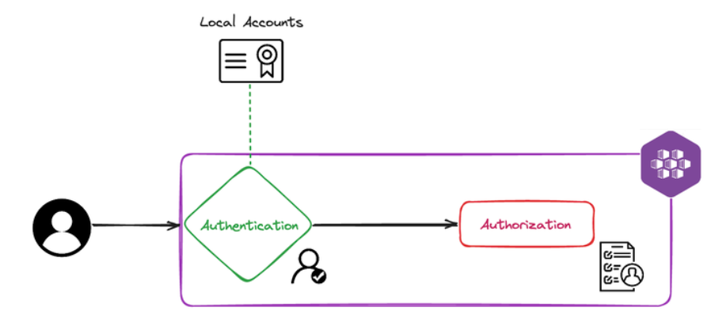
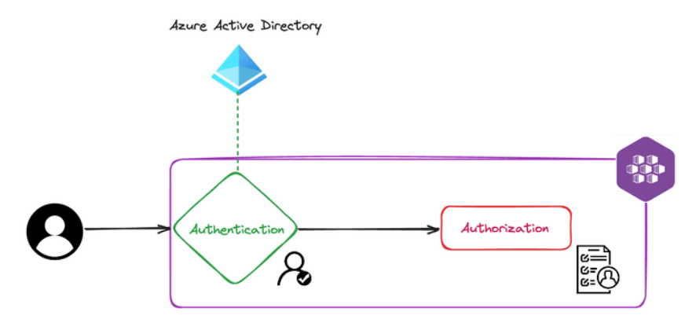
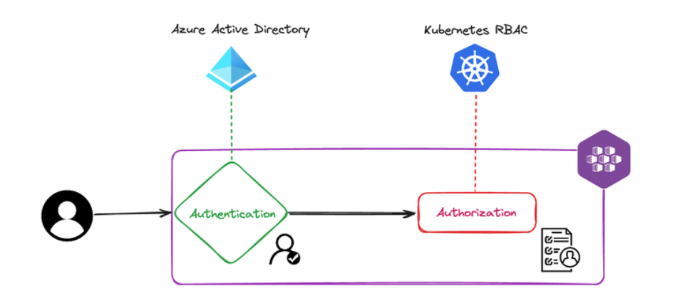
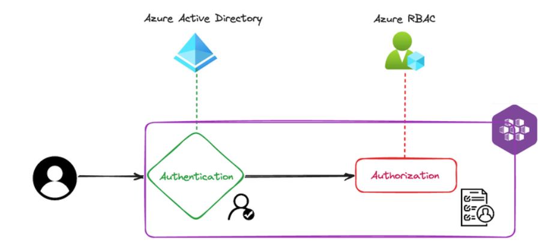
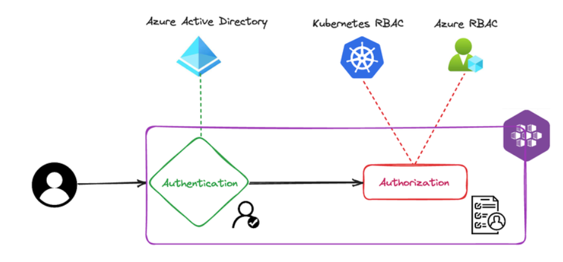

# RBAC in AKS (Azure Kubernetes Service)
AKS, Microsoft's Azure Kubernetes Service, offers three distinct RBAC (Resource-Based Access Control) options to manage access within the AKS cluster:

1. **Local Accounts with Kubernetes RBAC**
2. **Azure AD Authentication with Kubernetes RBAC**
3. **Azure AD Authentication with Azure RBAC**

To better understand these options and their functionality, let's delve into the specific requirements of our AKS cluster. Our AKS deployment is tailored to accommodate three main user roles:

- **Cluster Admins:** This role represents the super user, wielding comprehensive access privileges across the entire cluster.
- **SRE users:** SRE (Site Reliability Engineering) users possess write access limited to selected namespaces, empowering them to deploy, delete, and edit Kubernetes objects as needed.
- **Developers:** Developers are granted read-only access to specified namespaces, allowing them to view Kubernetes objects without the ability to make alterations or deletions.


Additionally, we have established three corresponding Azure Active Directory (AAD) groups to encapsulate these user roles:


| AAD Group                        | Type of Users      |Scope                                                       |
|----------------------------------|--------------------|------------------------------------------------------------|
|cloudblogs-aks-cluster-admin-[env]|Cluster Admin       |Write access to the entire cluster                          |
|cloudblogs-aks-developers-[env]   |Developers          |Read acccess to selected namespaces                         |
|cloudblogs-aks-sre-[env]          |SRE Users           |Write access to selected namespaces                         |

<span style="color:red;"><i>
** [env] represents the cluster environment (like, staging, pre-prod, prod, etc...)
</i></span>

With these requirements outlined, let's explore each RBAC option in detail, beginning with Authentication with/without Azure Active Directory, followed by different Authorization options, and understand why a particular option is chosen for our cluster.

## Authentication using Local Account (Local Accounts with Kubernetes RBAC)
When Azure Active Directory (AAD) integration is not enabled, AKS, by default, uses local account based on x509 certificates for authentication (its native to Kubernetes). This means that users and admins get an X509 client certificate that is local to the cluster referred to as local accounts.

<span style="color:red;"><i><b>
On clusters, where AAD integration is not enabled, users and admin will have the same full access to the cluster resources. Hence, this is not a recommedned RBAC approach. 
</b></i></span>



## Authentication using Azure AD
When AAD integration is enabled, as a result of issuing the _get-credentials_ command for the cluster, users will have an empty kubeconfig file. When a user attempts to execute a command against the cluster for the first time, kubectl will try to sign the user in prompting an OAuth2 device code flow. On successful authentication, it will pull down the credential into the local kubeconfig file for subsquent calls to the cluster.

```
$ kubectl get pods 
To sign in, use a web browser to open the page <https://microsoft.com/devicelogin> and enter the code XXXXXXXXX to authenticate.
```


But note, the AAD authentication can be bypassed if you still have "Kubernetes Local Account" enabled on the AKS cluster. The user can use _get-credentials --admin_ command and pull down the X509 certificate into kubeconfig file. This will bypass the AAD authentication and use x509 certificate instead.

<b><i>Hence, It is highly recommended that we disable the "Kubernetes Local Account" option on the AKS cluster.</i></b>


## Authorization
There are also 3 different ways to implement authorization in AKS described below. _Let's consider that AKS-Managed AAD integration is enabled and Kuberentes local Account is disabled to assure complete security in all the below scenarios._

### Kubernetes RBAC
Since we have considered that AAD integration is enabled for authentication and local accounts are disabled, no user or identity has any sort of access to the cluster by default. 

To create Kubernetes RBAC, at least one identity must initially have admin access to the cluster. Hence, in this model of authorization, it is required that an AD group be defined to have admin access to the cluster from the beginning, upon the creation of the cluster. Then, users that are members of this AAD group can configure the rest of the access control for other AD users, groups, or service principles by assigning them Kubernetes roles and cluster roles.

*_In our cluster, we have an AAD Group "cloudblogs-aks-cluster-admin" which was assigned as the cluster admin while enabling AAD authentication. All users in this AAD group has super user access to the cluster, and they have access to configure rest of the access control._*



In Kubernetes RBAC, the access is controlled using Kuberentes role and rolebindings objects. So, let's first understand what is a Role, and a Role Binding. 

**Role:**
A role is a collection of access in a specific namespace. In our cluster requirement, we are having two roles:

- read-access-developer-role: As the name indicates, it only gives read access to all resources within a namespace. A user with this role, can only view or describe the core K8 objects, but can't alter it. He can't create user, or make changes to the namespace quotas & limits. This role is extended to the developers so that they can view the deployments. In order to deploy a change, the developer has to check-in the code to the git repo which triggers the CI/CD pipeline and the pipeline does the change deployment.

- editor-access-sre-role: This roles gives write permission to selected resources within a namespace. This role is extended to the SRE resources to troubleshoot or make temporary changes to the deployment from the command prompt. The CI/CD pipeline SPN is also assigned the same role so that the pipelines can perform deployment.

```yaml
apiVersion: rbac.authorization.k8s.io/v1
kind: Role
metadata:
  namespace: riskiq
  name: read-access-developer-role
rules:
- apiGroups: [""]
  resources: ["*"]
  verbs: ["get", "list", "watch"]
---
apiVersion: rbac.authorization.k8s.io/v1
kind: Role
metadata:
  namespace: riskiq
  name: editor-access-sre-role
rules:
- apiGroups: [""]
  resources: ["pods", "deployments", "services", "configmaps", "secrets", "jobs", "cronjobs"]
  verbs: ["create", "update", "delete", "patch", "get", "list", "watch"]
```

**Role Binding:**
A role binding is a role assignemnt to an User or AAD Group to perform the action within a namespace. We have 2 rolebindings defined in our cluster.

- read-access-developer-role-binding-aad: Assigns role read-access-developer-role to ADD Group "cloudblogs-aks-developers". 

- editor-access-sre-role-binding-aad: Assigns role editor-access-sre-role to ADD Group "cloudblogs-aks-sre". 

```yaml
kind: RoleBinding
apiVersion: rbac.authorization.k8s.io/v1
metadata:
  name: read-access-developer-role-binding-aad
  namespace: riskiq
roleRef:
  apiGroup: rbac.authorization.k8s.io
  kind: Role
  name: read-access-developer-role
subjects:
- kind: Group
  namespace: riskiq
  name: developer-aad-group-id
---
kind: RoleBinding
apiVersion: rbac.authorization.k8s.io/v1
metadata:
  name: editor-access-sre-role-binding-aad
  namespace: riskiq
roleRef:
  apiGroup: rbac.authorization.k8s.io
  kind: Role
  name: editor-access-sre-role
subjects:
- kind: Group
  namespace: riskiq
  name: sre-aad-group-id

```

_Simillar to Role, and RoleBinding, there is ClusterRole, and ClusterRoleBinding to control access at the cluster level. In our AKS cluster, the cluster level access is only with the admin, and we are controlling that using the admin AAD group "cloudblogs-aks-cluster-admin". Hence, I will not go into that in this document._

### Azure RBAC
Azure RBAC will take the Azure AD integration one step further and will take care of both authentication and authorization inside an AKS cluster. You don't need to create any YAML manifests (role and role bindings) to manage user access in the namespaces. After the creation of the cluster, you can use the built-in Azure roles for AKS (which include AKS RBAC Admin, AKS RBAC Cluster Admin, AKS RBAC Reader, and AKS RBAC Writer) to assign to Azure identities such as a user, group, or service principal. The idea here is make it work similarly as the other Azure services by using Azure AD roles (IAM) only.



#### Built-in AKS RBAC roles
There are primarily 5 major type of built-in roles:

**Azure Kubernetes Service Cluster User Role:**
- allows az aks get-credentials to be used without the --admin flag. (This is the only purpose of "Azure Kubernetes Service Cluster User Role".) 

- The result, on a Microsoft Entra ID-enabled cluster, is the download of an empty entry into .kube/config, which triggers browser-based authentication when it's first used by kubectl.

- All users, and AAD groups must be assigned this role, when AAD authentication is enabled.

**Azure Kubernetes Service RBAC Cluster Admin:**
- This role is a built-in AKS role that grants full administrative access to the entire AKS cluster and <span style="background-color: yellow;"><b>its associated resources.</b></span>

- Cluster admins have full control over all resources within the AKS cluster, including nodes, namespaces, workloads, and RBAC itself.

- They can perform actions such as creating, updating, and deleting resources, managing RBAC roles and role bindings, scaling the cluster, and managing network policies.

When you enable AAD authentication on your AKS cluster, it asks you for an AAD group. It treats that AAD Group as the Cluster Admin, and assigns this role "Azure Kubernetes Service RBAC Cluster Admin". In our case, this group name is "cloudblogs-aks-cluster-admin".

When it does so, It creates a cluster-role-binding "aks-cluster-admin-binding-aad" in the k8 cluster that gives the admin access to the group. 
```yaml
// You can see that by running the following command:
kubectl get clusterrolebindings | grep 'aad'

// the role looks something like this.
apiVersion: rbac.authorization.k8s.io/v1
kind: ClusterRoleBinding
metadata:
  annotations:
    kubectl.kubernetes.io/last-applied-configuration: |
      {"apiVersion":"rbac.authorization.k8s.io/v1","kind":"ClusterRoleBinding","metadata":{"annotations":{},"labels":{"addonmanager.kubernetes.io/mode":"Reconcile","
kubernetes.io/cluster-service":"true"},"name":"aks-cluster-admin-binding-aad"},"roleRef":{"apiGroup":"rbac.authorization.k8s.io","kind":"ClusterRole","name":"cluster
-admin"},"subjects":[{"apiGroup":"rbac.authorization.k8s.io","kind":"Group","name":"d35e2803-7215-4ca9-9bf1-a3a7dc25ca5c"}]}
  creationTimestamp: "2024-03-04T16:44:16Z"
  labels:
    addonmanager.kubernetes.io/mode: Reconcile
    kubernetes.io/cluster-service: "true"
  name: aks-cluster-admin-binding-aad
  resourceVersion: "383"
  uid: 4b211ffb-e5ff-4cfd-8da3-8d1e3dee9d87
roleRef:
  apiGroup: rbac.authorization.k8s.io
  kind: ClusterRole
  name: cluster-admin
subjects:
- apiGroup: rbac.authorization.k8s.io
  kind: Group
  name: d35e2803-7215-4ca9-9bf1-a3a7dc25ca5c
```

**Azure Kubernetes Service RBAC Admin:**
- This role is also a built-in AKS role, but it provides administrative access focused specifically on RBAC within the AKS cluster.

- RBAC admins have the authority to manage RBAC roles and role bindings within the AKS cluster <span style="background-color: yellow;"><b>but do not have full control over other cluster resources. E.g. if you have a storage class that dynamically creates azure disk. This permission will fail.</b></span>

- They can create, update, and delete RBAC roles and role bindings, granting or revoking permissions to users, service principals, or groups.

**Azure Kubernetes Service RBAC Reader:**
- This role grants read-only access to resources within the AKS cluster.

- Users with this role can view (read) the configuration and status of resources within the AKS cluster, such as pods, deployments, services, and other Kubernetes objects.

- They cannot modify or create resources, nor can they perform any administrative actions on the cluster.

**Azure Kubernetes Service RBAC Writer:**
- This role grants permissions to create, update, and delete resources within the AKS cluster.

- Users with this role have write access to resources, allowing them to perform actions such as deploying applications, updating configurations, and scaling deployments within the AKS cluster.

- However, they do not have administrative privileges to manage RBAC or other cluster-level settings.

You can assign these role to the Azure AD groups to get the access for the users in the group. <span style="color:red;"><b><i> But there is one "catch" though: you can't use the Portal and assign this role using the Access Control (IAM) blade from the AKS service because it will assign that role for all namespaces inside the cluster, not just for namespace needed. </i></b></span>

```
az role assignment create --role "Azure Kubernetes Service RBAC Admin" --assignee <<groud-id for cloudblogs-aks-developers >> --scope /subscriptions/<<subscription>>/resourcegroups/<<rg>>/providers/Microsoft.ContainerService/managedClusters/<<cluster-name>>/namespaces/riskiq
```
Note that the --scope property assigns that role only for the riskiq namespace. One more downside for this approach is that you can't see this role assignment in the Portal either. You will need to utilize Az CLI to see the scopes you have assigned for namespaces:
```
az role assignment list --scope /subscriptions/<<subscription>>/resourcegroups/<<rg>>/providers/Microsoft.ContainerService/managedClusters/<<cluster-name>>/namespaces/riskiq
```
At this point, users from group cloudblogs-aks-developers can login using az aks get-credentials and can perform any operations in the namespace riskiq using tools like kubectl. 

In our cluster, our AAD groups are assigned the roles listed below.

| AAD Group                        | Type of Users      |Azure RBAC Role                                             |
|----------------------------------|--------------------|------------------------------------------------------------|
|cloudblogs-aks-cluster-admin-[env]|Cluster Admin       |Azure Kubernetes Service RBAC Cluster Admin & Azure Kubernetes Service Cluster User Role                 |
|cloudblogs-aks-developers-[env]   |Developers          |Azure Kubernetes Service RBAC Reader & Azure Kubernetes Service Cluster User Role                        |
|cloudblogs-aks-sre-[env]          |SRE Users           |Azure Kubernetes Service RBAC Write & Azure Kubernetes Service Cluster User Role                         |

### Kubernetes RBAC and Azure RBAC*
You can also use both the Kubernetes RBAC and Azure RBAC together. For the Azure identities such as subscriptions, resource groups, and resources you can use Azure RBAC, while Kubernetes RBAC can be used for the cluster local identities such as namespace, secrets, Pods, etc.



<span style="background-color: yellow;"><i><b>
In our cluster, we are using Kubernetes RBAC for authorization. We have role and role bindings defined for each namespace that controls the access of developers and SRE users (more easily with YAMLs). At the sametime, Azure RBAC controls the access to the Azure Resources. </b></i></span>

<span style="background-color: yellow;"><i><b>
For example, a user with "Kubernetes RBAC" only can't provision a Azure Disk dynamically when you are spinning up sql database storage in the Kubernetes cluster. Your account must have access to the Azure resources to create disk. 
</b></i></span>

## Our AAD Group Details
This section talks about all AAD groups we have created in our AAD for controlling the access to the cluster in different environments.

| Environment | AAD Group Name | AAD Group Object Id |
|-|-|-|
|QA/Staging/PoC/Dev |cloudblogs-aks-developers-qa|7a3dd05e-d14e-4169-b852-5769968653d5|
|QA/Staging/PoC/Dev |cloudblogs-aks-sre-qa|92f44002-dfe2-490d-9c2e-7a82ff0c9e0c|
|QA/Staging/PoC/Dev |cloudblogs-aks-cluster-admin-qa|d35e2803-7215-4ca9-9bf1-a3a7dc25ca5c|
|ppe |cloudblogs-aks-developers-ppe|4ff10d86-c465-4e6c-a700-94cc52ece824|
|ppe |cloudblogs-aks-sre-ppe|8998bc37-0e3f-4d38-b3f3-9601f4545102|
|ppe |cloudblogs-aks-cluster-admin-preprod|777187a1-638b-44a1-8217-d1f12daf1e9b|
|prd |cloudblogs-aks-developers-prd|61121b57-a987-42b2-ac40-53bca816083a|
|prd |cloudblogs-aks-sre-prd|75df8d63-fa7d-4501-8aae-b475a6644d6e|
|prd |cloudblogs-aks-cluster-admin-prod|89351c2c-c2ef-4760-9984-05db78e334af|

## Helm Command to Apply Access Control
We have created a helm package _apps/accesscontrol to easily manage access for developers, and sre users. You can use the following commands to provision them access.

If you are adding a new namespace, you will have to add a new yaml in the _apps/accesscontrol/templates folder.

```
cd ./akscluster

// Staging 
helm install accesscontrol ./_apps/accesscontrol --set aadGroup.developer=7a3dd05e-d14e-4169-b852-5769968653d5,aadGroup.sre=92f44002-dfe2-490d-9c2e-7a82ff0c9e0c,aadGroup.pipelineSPN=49c4bb41-8997-42d6-963c-98f58c69d7e7

// ppe/pre-production 
helm install accesscontrol ./_apps/accesscontrol --set aadGroup.developer=4ff10d86-c465-4e6c-a700-94cc52ece824,aadGroup.sre=8998bc37-0e3f-4d38-b3f3-9601f4545102,aadGroup.pipelineSPN=49c4bb41-8997-42d6-963c-98f58c69d7e7

// prd/production 
helm install accesscontrol ./_apps/accesscontrol --set aadGroup.developer=61121b57-a987-42b2-ac40-53bca816083a,aadGroup.sre=75df8d63-fa7d-4501-8aae-b475a6644d6e,aadGroup.pipelineSPN=49c4bb41-8997-42d6-963c-98f58c69d7e7

```

## Configure Terraform
In our Terraform scripts, we are using Kubernetes & Helm provider to communicate with the AKS cluster, and deploy Kubernetes objects like secrets, storageclass, secretproviders while provisioning resources. Hence, it is important to understand how to configure Kubernetes Provider with different Authentication Options, we discussed above. 

### With Local Account Authentication
To configure the Kubernetes provider in Terraform, while authentication is through local accounts, we can use the Kubernetes native x509 certificate which has the admin access to the cluster. The script will look something like this.

```
data "azurerm_kubernetes_cluster" "example" {
  name                = "myakscluster"
  resource_group_name = "my-example-resource-group"
}

provider "kubernetes" {
  host                   = "${data.azurerm_kubernetes_cluster.example.kube_config.0.host}"
  client_certificate     = "${base64decode(data.azurerm_kubernetes_cluster.example.kube_config.0.client_certificate)}"
  client_key             = "${base64decode(data.azurerm_kubernetes_cluster.example.kube_config.0.client_key)}"
  cluster_ca_certificate = "${base64decode(data.azurerm_kubernetes_cluster.example.kube_config.0.cluster_ca_certificate)}"
}  

**Note: data.azurerm_kubernetes_cluster.example.kube_config in the script.
```

### AAD Authentication (with Local Account Enabled)
Even when AAD integration is enabled, the local account also remains enabled unless it is explicitly disabled. Hence, the terraform script can possibly bypass the AAD authentication.

It is same as an user using "--admin" while issuing "az aks get-credentials" command, the kubernetes x509 certificate is pulled down even though you have AAD is enabled. The AAD integration is ignored. 

```
az aks get-credentials --resource-group [rg_name] --name [aks_name] --overwrite-existing --admin
```

To configure the Kubernetes provider in Terraform, while authentication is through AAD (but local account enabled), we can statically define TLS certificate credentials (data.azurerm_kubernetes_cluster.example.kube_admin_config.0.*).

```
data "azurerm_kubernetes_cluster" "example" {
  name                = "myakscluster"
  resource_group_name = "my-example-resource-group"
}

provider "kubernetes" {
  host                   = "${data.azurerm_kubernetes_cluster.example.kube_admin_config.0.host}"
  client_certificate     = "${base64decode(data.azurerm_kubernetes_cluster.example.kube_admin_config.0.client_certificate)}"
  client_key             = "${base64decode(data.azurerm_kubernetes_cluster.example.kube_admin_config.0.client_key)}"
  cluster_ca_certificate = "${base64decode(data.azurerm_kubernetes_cluster.example.kube_admin_config.0.cluster_ca_certificate)}"
}

**Note: ata.azurerm_kubernetes_cluster.example.kube_admin_config in the script.
```

### AAD Authentication (with Local Account Disabled) - Recommended
To configure the Kubernetes provider in Terraform, while authentication is through AAD (but local account disabled), we can use the below configuration.

```
data "azurerm_kubernetes_cluster" "example" {
  name                = "myakscluster"
  resource_group_name = "my-example-resource-group"
}

provider "kubernetes" {
  host                   = data.azurerm_kubernetes_cluster.example.kube_config.0.host
  cluster_ca_certificate = base64decode(data.azurerm_kubernetes_cluster.example.kube_config.0.cluster_ca_certificate)

  exec {
    api_version = "client.authentication.k8s.io/v1beta1"
    command     = "kubelogin"
    args = [
      "get-token",
      "--login",
      "azurecli",
      "--server-id",
      "6dae42f8-4368-4678-94ff-3960e28e3630", # Azure Kubernetes Service AAD Server. 
      "|",
      "jq",
      ".status.token"
    ]
  }
}

Note: "6dae42f8-4368-4678-94ff-3960e28e3630" is a hard-coded value. Azure Kubernetes Service (AKS) AAD Server is a feature that enables Azure Active Directory (AAD) integration with AKS clusters. 
```


## Useful Commands
```
//find out the role bindings for the user or AAD group id.
kubectl get rolebindings --all-namespaces -o=jsonpath='{range .items[*]}{.metadata.namespace}{"\t"}{.metadata.name}{"\t"}{.subjects[*].kind}{"\t"}{.subjects[*].name}{"\n"}{end}' | grep 92f44002-dfe2-490d-9c2e-7a82ff0c9e0c


//Assign Pipeline SPN Cluster Admin Role
az role assignment create --role "Azure Kubernetes Service RBAC Admin" --assign
ee 49c4bb41-8997-42d6-963c-98f58c69d7e7 --scope /subscriptions/433cb7d3-bac1-4059-bacf-afb085b7a62b/resourcegroups/aksoc-stg-eastus-rg/providers/Microsoft.ContainerS
ervice/managedClusters/aksoc-stg-eastus

```