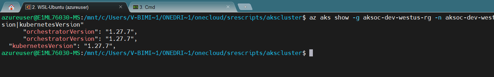
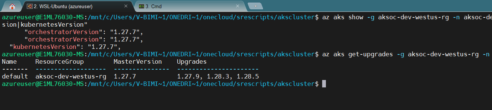
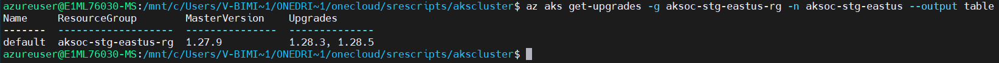
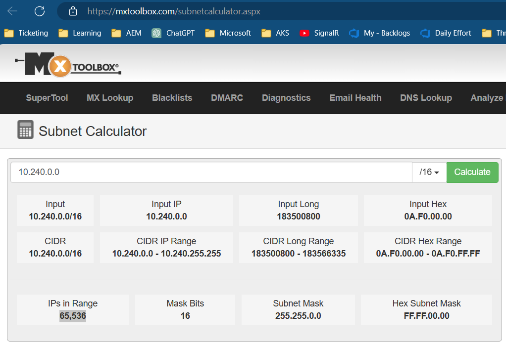
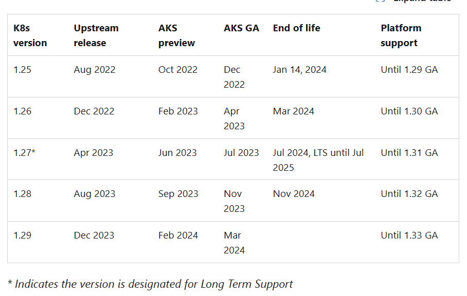
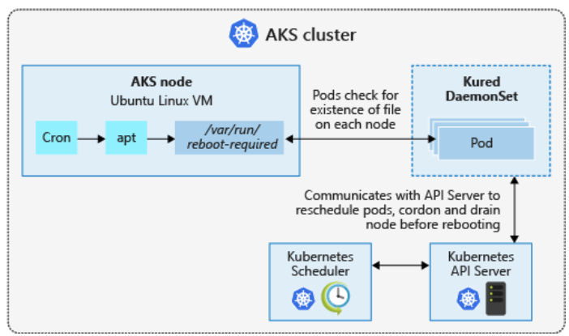

# Upgrade AKS Cluster with zero Downtime
Before undestand the steps on how to upgrade the AKS service. Let's undestand the AKS versioning. 

## 1. AKS Versioning
Kubernetes uses the standard Semantic Versioning scheme, which means it follows the format of [major].[minor].[patch].

E.g. version 1.28.5

- 1 would be the major version (Gets changed only when incompatible API changes or backward compatibility is broken)
- 28 would be the minor version (Gets releases 9–12 months after 19)
- 5 being the patch version (Gets releases the fastest as weekly)

AKS supports the latest general available (GA) minor version (N) and 2 minor versions prior to that (N-2). For example, version 1.28.x is the latest GA minor version, AKS would support
- 1.28.x
- 1.27.x
- 1.26.x

Within each minor version, AKS also supports 2 stable patch versions. It means, [major].[N-2].[P-2] to [major].[N].[P] would be supported by Azure platform. 

Let's say, 1.28.5 is the latest release version. In that case, AKS would support from version 1.26.3 to  1.28.5. 
```
// List the upgrades available in AKS.
It tells you also the upgrade path based on which version you are currently in and in which region.
az aks get-versions -l eastus -o table

az aks get-versions -l westus -o table
```


```
// List the current version of your AKS service
az aks show -g <resource group name> -n <AKS cluster name>| grep -E "orchestratorVersion|kubernetesVersion"

az aks show -g aksoc-dev-westus-rg -n aksoc-dev-westus| grep -E "orchestratorVersion|kubernetesVersion"
```


```
// List the upgrades your cluster is eligible for.
az aks get-upgrades -g aksoc-dev-westus-rg -n aksoc-dev-westus --output table
```


It means, Minor upgrades need to be performed sequentially. For example, from version 1.27.9 to 1.28.3, and then 1.28.3 to 1.28.5.

## 2. Upgrade Pre-Requisite
3 important prerequisite checks before heading toward the upgrade.

#### >> ** Please make sure there are sufficient private IP addresses within the AKS associated subnet if the cluster is running with Azure CNI. The rule of thumb is to have

- The amount of nodes across node pools — N
- The max amount of Pods on each node — P
- The private IP addresses required N + (N+1)*P

For example, having the total nodes of 30 across 3 node pools, and each node could host at most 30 Pods (default setting), the total private IP addresses required would be:

30 + (31*30) = 961

If your subnet CIDR is 10.240.0.0/16, you can have 65,536 no of IPs which is good range to accomodate 961 IPs.


#### >> ** Please make sure there is no Pod Disruption Budget (PDB) that would be potentially blocking AKS cluster upgrade process. Essentially, “maxUnavailable” and “minAvailable” would need to be set according to your workload. For example, if you have only 1 Pod hosting the application, the option is either not set a PDB or set “maxUnavailable” at “1” and plan the application down time with the application team. 

#### >> ** Administrators could decide whether to only upgrade control plane (master nodes) or both control plane and worker nodes.


## 3. Upgrade AKS
Upgrading of a Kubernetes Cluster onto a new version is no easy task, but doable! The trick is to establish a workflow and to stick to it. Our cluster has 3 major type of components.
- Master Node / Control Panel (this is not visible from Portal, but needs upgrade)
- System Node Pool (Pool where the system components like ingress controller is running)
- User Node Pool (Pool where the user apps are running)

We will have to upgrade each of the components one by one. 

### 3.1. Add Temporary Node Pool
In order to ensure, there is no outage. We must add a temporary User Node Pool & System Node Pool, and shift all playloads to it. Once the pools are free from payload, they will be safe for upgrade.

#### Step0: Set the ENV Variables
```
export RESOURCE_GROUP=YOUR_GROUP_NAME
export CLUSTER_NAME=k8scluster
export VMSIZE="Standard_DS2_v2"
export NODECOUNT=2
export USERNODEPOOL="userpool1"
export SYSTEMNODEPOOL="systempool1"
export USERNODEPOOLTEMP="userpooltemp"
export SYSTEMNODEPOOLTEMP="systempooltemp"
```

#### Step1: Add a Temporary User Node Pool
```
az aks nodepool add --resource-group $RESOURCE_GROUP --cluster-name $CLUSTER_NAME --node-vm-size $VMSIZE --name $USERNODEPOOLTEMP --node-count $NODECOUNT --mode User --os-sku Ubuntu
```

#### Step2: Add a Temporary System Node Pool
```
az aks nodepool add --resource-group $RESOURCE_GROUP --cluster-name $CLUSTER_NAME --node-vm-size $VMSIZE --name $SYSTEMNODEPOOLTEMP --node-count $NODECOUNT --mode System --os-sku Ubuntu
```

### 3.2. Cordn the Nodes
t's generally recommended to run the kubectl drain command after you've cordoned a node. Cordoning a node prevents new pods from being scheduled onto it, ensuring that no new workloads are added while you perform maintenance or other operations on the node. Once the node is cordoned, you can safely drain it to evict the existing pods and prepare it for maintenance.

kubectl cordon NODE_NAME

### 3.2. Drain the loads out from Nodes
Now that you have node pool for user and system, you should shift all running payloads to the temporary node pool, and free up the old ones. (You must make sure you have no payload running with replicaset=1. Otherwise, you will see a short outage.).

```
// list all the nodes in the OLD USER NODE POOL
kubectl get nodes -owide | grep $USERNODEPOOL

// list all the nodes in the OLD SYSTEM NODE POOL
kubectl get nodes -owide | grep $SYSTEMNODEPOOL

// disable all the above listed nodes one by one. This moves all payloads out of the node, and runs them on the temp NODEPOOL.
kubectl drain <node1>
kubectl drain <node2>
kubectl drain <node2>
```


### 3.3. Upgrade the K8 Control Panel
```
// list the upgrades available
az aks get-upgrades --resource-group $RESOURCE_GROUP --name $CLUSTER_NAME


// Upgrade the control panel
az aks upgrade --resource-group $RESOURCE_GROUP --name $CLUSTER_NAME --kubernetes-version 1.17.9 --control-plane-only

```
Note: You must NOT upgrade to the latest version in one go. You must upgrade the panel to all the upgrades sequentially.

### 3.4. Upgrade the System Node Pool
After having upgraded the control plane, we can upgrade the system node pool and user node pool.
```
az aks nodepool upgrade --resource-group $RESOURCE_GROUP --cluster-name $CLUSTER_NAME --kubernetes-version 1.17.9 --name $SYSTEMNODEPOOL

az aks nodepool upgrade --resource-group $RESOURCE_GROUP --cluster-name $CLUSTER_NAME --kubernetes-version 1.17.9 --name $USERNODEPOOL

```

### 3.5. Uncordn the Node Pools
The upgrade process uncordons all nodes in the upgraded pool, just check that and then drain each node in the other pool. This way all your pods will migrate back to the default pool, which is now running on the higher version.

```
TO BE ADDED
```


### 3.6. Remove the Temporary Node Pools
```
$ az aks nodepool update --resource-group $RESOURCE_GROUP --cluster-name $CLUSTER_NAME --name $SYSTEMNODEPOOL --mode System

$ az aks nodepool delete --resource-group $RESOURCE_GROUP --cluster-name $CLUSTER_NAME --name $SYSTEMNODEPOOLTEMP

$ az aks nodepool update --resource-group $RESOURCE_GROUP --cluster-name $CLUSTER_NAME --name $USERNODEPOOL --mode User

$ az aks nodepool delete --resource-group $RESOURCE_GROUP --cluster-name $CLUSTER_NAME --name $USERNODEPOOLTEMP

```

### AKS Release Types
Reference1: https://learn.microsoft.com/en-us/azure/aks/supported-kubernetes-versions?tabs=azure-cli
Reference2: https://learn.microsoft.com/en-us/azure/aks/long-term-support

The Kubernetes community releases a new minor version approximately every four months, with a support window for each version for one year. In Azure Kubernetes Service (AKS), this support window is called "Community support." AKS supports versions of Kubernetes that are within this Community support window, to push bug fixes and security updates from the community releases.

After approximately one year, the Kubernetes version exits Community support and your AKS clusters are now at risk as bug fixes and security updates become unavailable. Hence, Microsoft has come up with one additional year of LTS (Long Term Support) to back port security fixes from the community upstream in the public repository.

LTS intends to give you an extended period of time to plan and test for upgrades over a two-year period from the General Availability of the designated Kubernetes version.




## 4. Node Image Version Upgrade (OS Upgrade)
As we all know that containers are essentially running as a process within the hosts (Azure Virtual Machines), keeping the host a secure environment is crucial. Therefore, OS security patches are performed to AKS Linux nodes on a nightly basis. However, this is not the case for AKS Windows nodes. That said, some security patches require hosts to reboot before those could be applied and this is the responsibility of AKS administrators. The reboots can be performed manually, or automatically using Kured (a daemonset) incase of Linux nodes.

Linux-based VMs use an Ubuntu or Azure Linux image, with the OS configured to automatically check for updates every day. If security or kernel updates are available, they're automatically downloaded and installed.



Some security updates, such as kernel updates, require a node reboot to finalize the process. A Linux node that requires a reboot creates a file named /var/run/reboot-required. This reboot process doesn't happen automatically.

You can use your own workflows and processes to handle node reboots, or use kured to orchestrate the process. With kured, a DaemonSet is deployed that runs a pod on each Linux node in the cluster. These pods in the DaemonSet watch for existence of the /var/run/reboot-required file, and then initiate a process to reboot the nodes.

**Note: When the Nodepool adds a new node (because of autoscaling), the original image is used to create the node. This new node receives all the security and kernel updates available during the automatic check every day but remains unpatched until all checks and restarts are complete.

### 4.1. Deploy Kured in AKS Cluster
To deploy the kured DaemonSet, install the following official Kured Helm chart. This creates a role and cluster role, bindings, and a service account, then deploys the DaemonSet using kured.
```
# Add the Kured Helm repository
helm repo add kubereboot https://kubereboot.github.io/charts/

# Update your local Helm chart repository cache
helm repo update

# Create a dedicated namespace where you would like to deploy kured into
kubectl create namespace kured

# Install kured in that namespace with Helm 3 (only on Linux nodes, kured is not working on Windows nodes)
helm install my-release kubereboot/kured --namespace kured --set controller.nodeSelector."kubernetes\.io/os"=linux
```

### 4.2. Upgrade Node Manually
By default, Linux nodes in AKS check for updates every evening. If you don't want to wait, you can manually perform an update to check that kured runs correctly. First, follow the steps to SSH to one of your AKS nodes. Once you have an SSH connection to the Linux node, check for updates and apply them as follows:
```
sudo apt-get update && sudo apt-get upgrade -y
```
If updates were applied that require a node reboot, a file is written to /var/run/reboot-required. Kured checks for nodes that require a reboot every 60 minutes by default.

### 4.3. Monitoring and Reviewing the Reboot Process
When one of the replicas in the DaemonSet detects that a node reboot is required, a lock is placed on the node through the Kubernetes API. This lock prevents more pods from being scheduled on the node. The lock also indicates that only one node should be rebooted at a time. With the node cordoned off, running pods are drained from the node, and the node is rebooted.

You can monitor the status of the nodes using the kubectl get nodes command. The following example output shows a node with a status of SchedulingDisabled as the node prepares for the reboot process:

```
kubectl get nodes -owide
```


