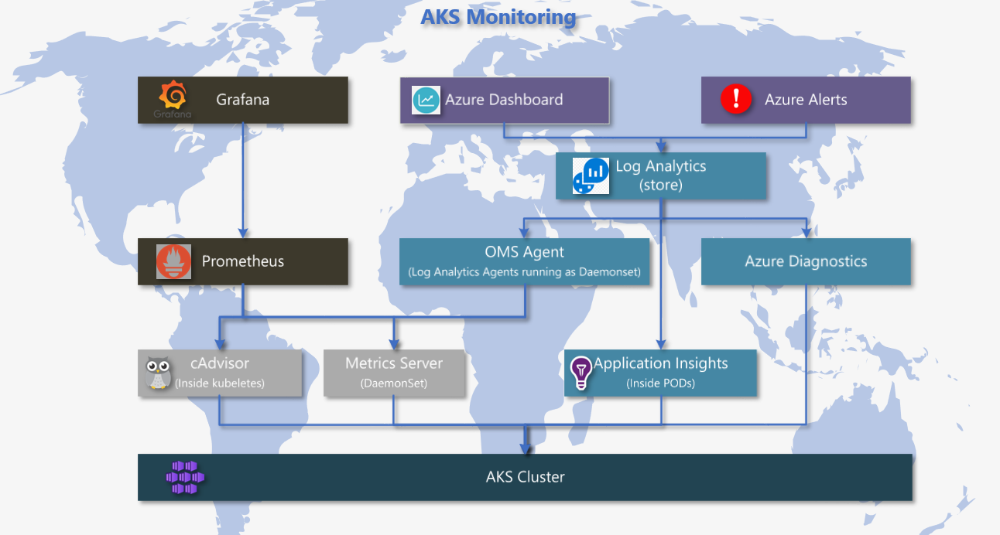

# **Comprehensive Guide to Monitoring in Azure Kubernetes Service (AKS)**

## **Introduction**

Monitoring in **Azure Kubernetes Service (AKS)** is crucial for maintaining the performance, health, and availability of both the applications and the infrastructure. Azure provides a variety of tools such as **Azure Monitor**, **Application Insights**, **Log Analytics**, and popular open-source solutions like **Prometheus** and **Grafana**. These tools work together to provide a comprehensive monitoring solution for both cluster and application-level insights.

This guide explores each monitoring component, explains how it’s installed, and outlines how they are interlinked in the AKS ecosystem. We will also include a diagram to illustrate the flow of monitoring data from the ground up.

## **Key Monitoring Components in AKS**

### **1. cAdvisor (Container Advisor)**

- **Purpose**: cAdvisor collects real-time container-level resource usage data (CPU, memory, disk I/O, and network traffic).
- **Installation**: cAdvisor is built into the **Kubelet** on each node and runs automatically as part of Kubernetes.
- **Data Captured**: Tracks CPU, memory, and disk usage for each container.
- **Data Flow**: The data collected by cAdvisor is accessed by other components like the OMS agent or Prometheus.

### **2. Metrics Server**

- **Purpose**: Collects resource metrics such as CPU and memory usage for pods and nodes across the cluster.
- **Installation**: Can be installed manually in AKS using Helm or YAML files. In most AKS setups, it comes pre-installed.

    ```bash
    kubectl apply -f https://github.com/kubernetes-sigs/metrics-server/releases/latest/download/components.yaml
    ```

- **Data Captured**: Provides high-level resource usage metrics to Kubernetes for features like **Horizontal Pod Autoscaling (HPA)**.
- **Data Flow**: Metrics Server metrics are exposed via the Kubernetes API for scaling purposes and can be accessed using commands like `kubectl top`.

### **3. OMS Agent (also called Log Analytics Agent)**

- **Purpose**: Aggregates logs, metrics, and telemetry from nodes, containers, and pods, forwarding them to **Azure Monitor**.
- **Installation**: Deployed as a **DaemonSet** when you enable **Azure Monitor for Containers** during AKS setup or afterward via CLI.

    ```bash
    az aks enable-addons --addons monitoring --resource-group <ResourceGroup> --name <ClusterName>
    ```

- **Data Captured**: Collects container logs, resource usage data, and node health metrics.
- **Data Flow**: The OMS agent forwards data from cAdvisor and Metrics Server to **Azure Monitor Logs**.

### **4. Diagnostic Settings**

- **Purpose**: Captures control plane logs and metrics such as kube-apiserver logs, audit logs, and scheduler logs.
- **Installation**: Configured in the Azure Portal or via Azure CLI. It forwards logs to destinations like Azure Monitor Logs or Event Hubs.

    ```bash
    az monitor diagnostic-settings create --name <diagnosticName> --resource <aksResourceId> --logs '[{"category": "kube-apiserver", "enabled": true}]'
    ```

- **Data Captured**: Control plane logs, audit logs, and other critical infrastructure logs.
- **Data Flow**: Control plane logs are forwarded to **Azure Monitor Logs** for further analysis.

### **5. Application Insights**

- **Purpose**: Collects telemetry data from applications, including performance metrics, request rates, and dependencies.
- **Installation**: Application Insights can be integrated by adding the **SDK** to the code or enabling auto-monitoring in certain setups.

    ```javascript
    const appInsights = require("applicationinsights");
    appInsights.setup("<instrumentation_key>").start();
    ```

- **Data Captured**: Tracks requests, dependencies, exceptions, and custom events for application monitoring.
- **Data Flow**: Application telemetry is sent to **Azure Monitor** for real-time diagnostics.

### **6. Prometheus**

- **Purpose**: An open-source monitoring system that scrapes metrics from Kubernetes components, such as cAdvisor, Kubelet, and custom application metrics.
- **Installation**: Installed using Helm or Kubernetes manifests. Commonly used with **Grafana** for visualizing metrics.

    ```bash
    helm install prometheus prometheus-community/prometheus
    ```

- **Data Captured**: Scrapes CPU, memory, and custom metrics from nodes, pods, and Kubelet endpoints.
- **Data Flow**: Prometheus stores metrics for querying, alerting, and visualization.

### **7. Grafana**

- **Purpose**: An open-source tool for creating visual dashboards of metrics scraped by Prometheus and other sources.
- **Installation**: Can be installed alongside Prometheus using Helm or Kubernetes manifests.

    ```bash
    helm install grafana grafana/grafana
    ```

- **Data Captured**: Grafana queries **Prometheus** and other data sources to create custom dashboards.
- **Data Flow**: Grafana visualizes data from **Prometheus** and other sources like **Azure Monitor**.

## **Data Flow in AKS Monitoring**

Below is the flow diagram showing how data is collected from the ground (nodes and containers) and flows up to **Azure Monitor** through various components.



## **Prometheus vs Azure Monitor**
Here’s a detailed comparison of **Prometheus** and **Azure Monitor (via OMS Agent)** in table format:

| **Feature**                      | **Prometheus**                                     | **Azure Monitor (via OMS Agent)**                  |
|-----------------------------------|---------------------------------------------------|---------------------------------------------------|
| **Data Types**                    | Time-series metrics (e.g., CPU, memory, network)  | Time-series metrics, logs, events, application telemetry |
| **Storage**                       | Local storage (can integrate with external storage like Thanos or Cortex for long-term storage) | Cloud-based storage in **Log Analytics** for metrics, logs, and telemetry |
| **Scalability**                   | Requires manual setup for high availability and scaling (e.g., with Thanos or federated Prometheus) | Fully managed by Azure, automatically scalable |
| **Visualization**                 | Custom dashboards using **Grafana**               | **Azure Dashboards** or **Workbooks** in Azure Monitor |
| **Alerting**                      | **Alertmanager** for alerts based on metrics      | **Azure Alerts** for metrics, logs, and application telemetry |
| **Retention**                     | Short-term by default (days or weeks, based on disk space) | Long-term with customizable retention policies in **Log Analytics** |
| **Integration**                   | Requires manual setup for integrations with other systems (e.g., external storage or alerting) | Seamless integration with **Azure Services** (Application Insights, Logic Apps, Event Hub, etc.) |
| **Data Retention**                | Short-term by default (without external storage like Thanos) | Long-term with customizable policies in **Log Analytics Workspace** |
| **Setup Complexity**              | Requires manual setup, customization, and management (e.g., scraping endpoints, scaling storage) | Managed by Azure, requires minimal setup for monitoring the entire AKS environment |
| **Cost**                          | Free (with operational costs for managing infrastructure and long-term storage) | Pay-as-you-go based on data ingestion and retention in **Log Analytics** |
| **Supported Metrics**             | Kubernetes components (cAdvisor, Kubelet) and custom app metrics | Kubernetes metrics, container logs, control plane logs, and custom app telemetry via **Application Insights** |
| **Long-Term Storage**             | Requires integration with external storage (e.g., Thanos or Cortex) for long-term storage | Automatically managed in **Log Analytics**, with configurable retention periods |
| **Ease of Use**                   | Requires manual configuration for scraping, alerting, and visualizations | Easy-to-use, out-of-the-box monitoring with pre-built dashboards, alerting, and telemetry |
| **Application Monitoring**        | Limited (can collect metrics from apps via custom Prometheus exporters) | Deep integration with **Application Insights** for app telemetry (requests, dependencies, errors, etc.) |
| **Security**                      | Requires manual security setup for monitoring infrastructure | Built-in security with Azure services, including role-based access control (RBAC), data encryption, and more |

### Key Takeaways:

- **Prometheus** is ideal if you're looking for a **self-managed**, **flexible** solution for scraping and visualizing time-series metrics. It requires manual setup and management but gives you full control.
  
- **Azure Monitor** offers a **fully managed** and **integrated** solution with long-term data storage, monitoring of both infrastructure and application-level telemetry, and seamless integration with other Azure services. It's ideal for large-scale or enterprise environments.


## **Conclusion**

Monitoring in AKS involves a layered approach where various components capture different types of data:

- **cAdvisor** and **Metrics Server** handle container and node metrics.
- The **OMS agent** forwards logs and metrics to **Azure Monitor**.
- **Diagnostic Settings** captures control plane logs.
- **Prometheus** and **Grafana** offer real-time monitoring and visualization.
- **Application Insights** tracks application-level telemetry.

Together, these components ensure that the cluster’s infrastructure and applications are well-monitored, allowing proactive actions based on insights from Azure Monitor.
